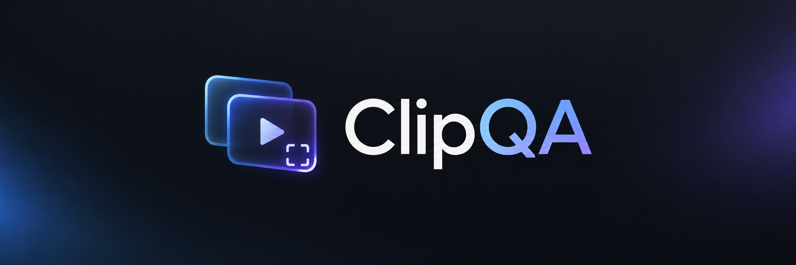

<div align="center">
  
  <p><strong>Record. Inspect. Compare.</strong></p>
  <p><a href="LICENSE"></a> </p>
</div>

**Video evidence for AI-assisted testing of desktop apps, websites, creative tools, and games.** Record a selected source, see screenshots while tests run, inspect subtle changes, compare before/after clips, look at a model from every angle, zoom into details, and score the result against a structured QA checklist.

ClipQA runs locally through MCP. It never moves your mouse, types, or activates application windows. Saved videos are available for you to watch, not just for an AI to analyze.

> **v0.3 public preview.** Windows Graphics Capture has been tested live on Windows. Linux X11 and macOS display backends have argument/parsing tests; native capture on those systems still needs validation. See [platform setup](docs/CAPTURE.md).

## Quick start

```sh
npx -y clipqa-mcp
```

MCP client configuration:

```json
{
  "mcpServers": {
    "clipqa": {
      "command": "npx",
      "args": ["-y", "clipqa-mcp"]
    }
  }
}
```

Node.js 20+ is required. FFmpeg and FFprobe are supplied through package dependencies. Override their locations with `CLIPQA_FFMPEG_PATH` and `CLIPQA_FFPROBE_PATH`. Change the session directory with `CLIPQA_DATA_DIR` (default `~/.clipqa/sessions`).

### Stronger Windows capture

The bundled FFmpeg may not include Windows Graphics Capture. This optional setup downloads a newer build from the Windows build provider linked by FFmpeg, verifies its published SHA-256, and installs it into `~/.clipqa/bin`:

```powershell
npx -y clipqa-mcp --setup-wgc
```

Restart your MCP client and call `capture_status`. Automatic selection prefers `gfxcapture` when available, falling back to `gdigrab`. An explicitly requested unavailable backend returns an error. Capture never silently switches from a window to an entire display.

## See what is happening

Ask your assistant:

> Record this app at 15 FPS, keeping the last 30 seconds. Show me a progress screenshot. Include a short video preview when something changes. Stop and show me the saved video when the test finishes.

- `recording_progress` returns a screenshot as an MCP image. With `includeVideo: true`, it also returns a short MP4 preview and its local path. Recording continues.
- Live previews use completed segments and lag by roughly two seconds. Early requests return `previewReady: false`.
- `get_clip` returns the completed video's absolute path and a video resource link.
- Inline video playback depends on your MCP client. A client with local-media support can render the path in chat; otherwise open it in a media player. Images use standard MCP image responses.

Saved videos, previews, screenshots, and reports stay on disk until explicitly deleted. ClipQA does **not** automatically erase evidence once an AI inspects it.

## Tools

| Tool | Purpose |
| --- | --- |
| `capture_status` | Detect capture backends and explain requirements. |
| `list_sources` | List Windows/X11 windows or macOS displays. |
| `list_windows` | List Windows/X11 titles and native handles. |
| `start_recording` | Record a source (exact title, title fragment or handle), optionally cropped, retaining the last N seconds, and following log files. |
| `recording_progress` | Return status, time remaining, a screenshot, and optionally a live video preview. |
| `wait_until_stable` | Wait until the recording stops changing, then return a screenshot. |
| `mark_event` | Attach actions, assertions, errors, or application logs to timestamps. |
| `attach_log` | Turn new lines of a log file (or the newest log in a folder) into timed events. |
| `stop_recording` | Stop capture and finalize the saved video. |
| `recover_session` | Rebuild the video of an interrupted or failed recording from its segments. |
| `get_clip` | Access a completed session's video. |
| `list_sessions` | Browse recordings. |
| `import_clip` | Copy an existing local video into a session on any platform. |
| `inspect_clip` | Return an event-labelled contact sheet, perceptual-change index and quality warnings. |
| `get_frames` | Retrieve specific frames (optionally cropped) with configurable image size. |
| `zoom_frame` | Show a labelled grid, then zoom into a cell, point or region at native resolution. |
| `analyze_motion` | Score fluidity: hitches, pops and uneven speed with timestamps. |
| `compare_clips` | Auto-align two runs, sample where they change, and write difference reports. |
| `orbit_plan` | Generate a 360° camera script (Roblox, Blender or generic) covering every angle plus close-ups. |
| `orbit_sheet` | Find each view in the recorded orbit and return labelled every-angle sheets. |
| `qa_review` | Return the QA checklist, a contact sheet and an automatic fluidity check. |
| `record_finding` | Record pass/fail/unclear per checkpoint, with zoomed evidence. |
| `qa_report` | Score the review (points per checkpoint) and write an HTML/JSON report. |
| `delete_session` | Delete a stopped session and all its artifacts. |
| `cleanup_sessions` | Preview or delete old sessions; defaults to a dry run. |

### Rolling recording

```json
{
  "hwnd": "123456",
  "backend": "auto",
  "fps": 15,
  "maxWidth": 1280,
  "maxSeconds": 300,
  "bufferSeconds": 30
}
```

Replace the handle with one from `list_sources`. Without `bufferSeconds`, the full recording is retained. Rolling mode removes old two-second disk segments while recording. A few extra seconds are temporarily retained for segment boundaries. Stopping saves only the last N seconds (or the available duration if shorter), removes working segments, drops older events, and shifts retained event timestamps to match the saved video.

This is a **disk buffer**, bounded by time rather than bytes. Preview exports and finalization need extra space. Saved previews remain until cleanup.

### Quality review checklist

`qa_review` gives the assistant a checklist of things that commonly go wrong, each with what to look for, how to verify it, and a point value:

- **Body proportions**: left/right symmetry, head/torso/limb ratios, joint placement, proportions holding steady while moving.
- **Mesh integrity**: twisted or candy-wrapped joints, spikes, holes and inverted faces, clipping through the body or floor, detached parts.
- **Pose and intent**: every part of the user's request checked by name (which hand, facing, prop, expression), anatomically possible poses, feet and hands actually in contact.
- **Motion**: fluidity (measured automatically by `analyze_motion`), natural timing and arcs, no jitter, clean loops.
- **Coverage**: checked from every angle with `orbit_plan` / `orbit_sheet`.
- **Materials**: textures, colours and lighting artefacts.

The assistant calls `record_finding` for every checkpoint (pass, fail or unclear, with a note and optional zoomed evidence). `qa_report` scores it: pass earns full points, unclear half, fail none. Any **blocker** failure makes the verdict **FAIL**; unchecked items make it **INCOMPLETE**; any other failure or a score below 85 is **NEEDS WORK**. The checklist directs the assistant's judgment; apart from motion fluidity, ClipQA does not detect these defects by itself.

### Every angle (360° orbit)

ClipQA never moves the camera itself. `orbit_plan` returns a script for the app to run while ClipQA records: by default 8 azimuths × 5 heights (below, level, 30°, 60°, top-down) at normal distance plus a 2.5× close-up pass (80 views, about 49 seconds). The camera cuts between views and holds each one, so `orbit_sheet` finds every view from the cuts and returns labelled sheets plus a timestamp per view for `zoom_frame`.

- **Roblox Studio**: run the Luau with Studio MCP `execute_luau` or the command bar. Target an instance path (`workspace.Rig`) or `selection`. The script clears the selection so selection boxes stay out of frame, runs in the background, and restores the camera.
- **Blender**: run the Python with the Blender MCP. It orbits the 3D viewport on a timer and restores the view.
- **Generic**: a list of views for any engine.

For Roblox, `logs: [{"path": "<LOCALAPPDATA>\\Roblox\\logs", "pattern": "CLIPQA_ORBIT"}]` on `start_recording` also turns each view into an event.

### Zoom

`zoom_frame` with `showGrid: true` returns the frame with a labelled grid (A1, B2, ...). Zoom into a cell (`"C2"`), a range (`"B2:C3"`), a `center` + `factor`, or a normalized `region`. The crop is taken from the full-resolution frame, upscaled with Lanczos and sharpened. The response reports the magnification; above 1× the extra detail is interpolated. For real detail, use an orbit close-up pass or record with a larger `maxWidth`.

### Logs and timing

Event timestamps are measured from the first captured frame. Before 0.3.0 they were measured from session creation, which put live events slightly ahead of the video. `attach_log` or `start_recording.logs` follows a file, or the newest `.log`/`.txt` in a folder, from its current end. Lines starting with an ISO-8601 time use that time; error and warning lines are tagged. For Roblox Studio output use the `Roblox\\logs` folder under `LOCALAPPDATA` with pattern `FLog::Output|FLog::Error|FLog::Warning`.

### Perceptual indexing and comparison

`inspect_clip` analyzes resized RGB frames using local structural similarity and color differences. Local scoring can find a small button flash that scene-cut detection misses. `indexFps` defaults to 15 and can be raised to 60. Analysis streams frames with bounded candidate storage and caches results. Contact sheets are capped at 24 images; exact-frame requests at 16.

`compare_clips` aligns the two runs automatically: first by a `mark_event` label present in both (actions preferred), otherwise by cross-correlating their motion. Low-confidence matches fall back to the clip starts with a warning. Passing `beforeStart`/`afterStart` aligns manually. `sampling: "changes"` (default) samples where either clip changes and around events; `"even"` spaces samples evenly. `analysisWidth` raises the comparison canvas up to 1280 px for small details. `ignoreRegions` uses normalized coordinates (0–1) to exclude expected changes. Reports include paired frames, difference maps, scores and timestamps. The highest-scoring pair is returned as an image in chat. Event labels appear under contact-sheet frames and beside report rows.

```json
{
  "beforeSessionId": "<baseline-session-uuid>",
  "afterSessionId": "<new-session-uuid>",
  "align": "auto",
  "seconds": 10,
  "samples": 30,
  "threshold": 0.08,
  "ignoreRegions": [{"x": 0.9, "y": 0, "width": 0.1, "height": 0.1}]
}
```

Reports identify **visual differences**, which can be intentional; they do not automatically establish a regression.

## Privacy and resources

- Windows/X11 capture targets one window. macOS captures an explicitly selected **display**, including other visible apps.
- Recorder processes are hidden and do not control input or focus.
- Recording excludes audio and webcams. Imported files are copied as supplied and may contain audio from their original recorder.
- ClipQA opens no network listener and does not upload recordings itself. Images returned over MCP go to your client, which may send them to its AI provider.
- One recording runs per MCP process. Configure FPS and `maxWidth` to manage overhead. Automatic encoder selection probes hardware first.
- Startup waits for actual frames. Wall-clock limits stop stalled capture. Normal shutdown finalizes recordings; concurrent event updates are serialized.
- Cleanup defaults to a preview and excludes active sessions.

## Validation

```sh
npm install
npm run check
npm test
npm run benchmark
npm run build
```

Tests use real FFmpeg video for rolling retention, subtle changes, clean controls, ignore masks and reports. A real MCP client exercises import → annotation → inspection → comparison → progress → cleanup. The opt-in Windows test creates its own animated window without activation and verifies WGC, rolling output and live previews. See [test instructions](docs/TESTING.md).

The original synthetic timestamp benchmark covers 8/8 defect intervals versus 2/8 with four periodic screenshots, using 144 versus 36 selected frames. That is **temporal evidence coverage**, not AI diagnosis accuracy, with unequal image budgets. Real-video tests separately verify the new analysis code. See [the evaluation protocol](docs/EVALUATION.md) for model evaluations.

## Remaining constraints

- Minimized apps may stop rendering; minimized Windows targets are rejected at startup. ClipQA does not restore or focus them. Protected content can remain black. Static/black-frame warnings flag suspicious evidence, not confirmed bugs.
- WGC needs a suitable OS, driver and FFmpeg build. X11 can include occluding windows and stops when a target is unmapped. Native Wayland and macOS window-only capture are not implemented.
- Fluidity analysis measures the recording, not the app's renderer. Record at 30–60 FPS; regularly repeated frames mean either a slow renderer or dropped capture frames.
- Sampling can miss changes between frames or below analysis resolution. Comparisons require aligned runs. Internal failures still need logs and reproducible test steps.
- Recording, analysis, disk writes and finalization consume resources. Zero slowdown is not guaranteed. Full recordings and saved previews grow until cleanup.
- Forced termination may leave segments without a finalized MP4. Use orderly shutdown; preserve interrupted sessions if you want to recover their evidence.
- Releases are published to npm and GitHub. Direct GitHub installs build from source on install (`prepare`) and remain available for testing unreleased commits.

The Roblox Studio plugin is deferred; Roblox support comes through the orbit script and log following. Core recording, progress, comparison and event tools work independently of any game engine.

## License

MIT. FFmpeg binaries have separate licenses; consult the selected distributor or package's license and source information.
