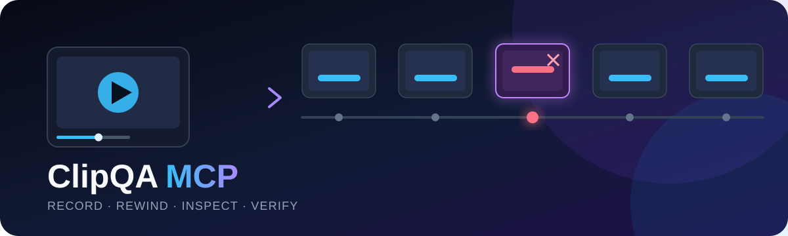

<div align="center">
  

  <p><strong>Frame-level evidence for AI-assisted QA</strong></p>

  <p>
    <a href="LICENSE"></a>
    
    
  </p>
</div>

Turn short screen recordings into precise, frame-level evidence for AI-assisted QA.

ClipQA MCP records one Windows application window in a hidden background process, synchronizes test events, and lets an AI inspect a lightweight contact sheet before requesting exact frames around a suspicious moment. It is designed for motion and timing defects that periodic screenshots commonly miss: UI flicker, placement jumps, animation stalls, collision glitches, and delayed state changes.

> **Status:** Windows-first public MVP. Recording uses FFmpeg's `gdigrab` window capture. Keep the target window unminimized during a test for dependable results.

## Why ClipQA

Four screenshots from a 30-second test can miss a defect that lasts 100 milliseconds. Sending all 900 frames from a 30 FPS recording is expensive and repetitive. ClipQA keeps the complete local recording, returns an overview, and exposes exact timestamps for focused inspection.

```text
test action → selected-window recording → timestamped overview
                                      ↘ exact frames around a failure
Roblox logs/events ────────────────────↗
```

## Privacy and interruption model

- Captures only the selected window title or HWND.
- Runs FFmpeg with a hidden process window.
- Does not move the mouse, type, focus windows, or automate the computer.
- Does not capture audio or the webcam.
- Does not upload recordings or open a network port.
- Stores sessions locally in `~/.clipqa/sessions` by default.
- Hides the mouse pointer by default.

The selected app should remain unminimized. It may sit behind other windows. Capture behavior for minimized or hardware-protected windows is not guaranteed by the MVP backend.

## Requirements

- Windows 10 or Windows 11
- Node.js 20 or later

An FFmpeg binary is installed through the package dependency. Advanced users can override it with `CLIPQA_FFMPEG_PATH` and `CLIPQA_FFPROBE_PATH`.

## Install and run

Run the current GitHub release directly with npm:

```powershell
npx -y github:WheresRace/clipqa-mcp
```

Or install globally:

```powershell
npm install --global github:WheresRace/clipqa-mcp
clipqa-mcp
```

### MCP client configuration

```json
{
  "mcpServers": {
    "clipqa": {
      "command": "npx",
      "args": ["-y", "github:WheresRace/clipqa-mcp"]
    }
  }
}
```

For local development:

```json
{
  "mcpServers": {
    "clipqa": {
      "command": "node",
      "args": ["C:/path/to/clipqa-mcp/build/index.js"],
      "env": {
        "CLIPQA_DATA_DIR": "C:/path/to/qa-recordings"
      }
    }
  }
}
```

## Available tools

| Tool | Purpose |
| --- | --- |
| `list_windows` | List visible windows, exact titles, and HWND values. |
| `start_recording` | Record one window quietly at 1–60 FPS. |
| `mark_event` | Attach a timestamped action, assertion, error, or note. |
| `stop_recording` | Stop FFmpeg gracefully and finalize the MP4. |
| `list_sessions` | List local test sessions and their state. |
| `inspect_clip` | Return a timestamped contact sheet from a time range. |
| `get_frames` | Return full-size images at up to 16 exact timestamps. |

Suggested agent workflow:

1. Call `list_windows` and identify Roblox or Roblox Studio.
2. Call `start_recording` using the exact title or HWND. The bundled FFmpeg resolves HWND values to the current title for compatibility.
3. Mark important inputs and assertions with `mark_event`.
4. Stop the recording after the test.
5. Call `inspect_clip` for a coarse overview.
6. Call `get_frames` around suspicious timestamps.
7. Correlate the visual symptom with Roblox client/server logs before changing code.

## Measuring effectiveness

The included benchmark compares four periodic screenshots per run with overview sampling augmented by timestamped events and detected visual changes:

```powershell
npm run benchmark
```

The benchmark reports **temporal evidence coverage**: whether at least one selected frame falls inside each labeled defect interval. This isolates the MCP's evidence-selection value. It does not claim to measure an AI model's final diagnosis accuracy.

Scenarios include:

- A brief purchase-button flicker.
- A placement preview teleport.
- A dialog that closes late.
- A stuck loading overlay.
- A misplaced tooltip flash.
- A collision teleport.
- A late purchase-state update.
- An animation freeze without an input event.
- A clean control run.

For a real Roblox evaluation, record a fixed suite of seeded bugs, keep the expected defect and timestamp hidden from the model, and score detection, localization, diagnosis, and false positives separately. See [the evaluation protocol](docs/EVALUATION.md).

## Development

```powershell
npm install
npm run check
npm test
npm run benchmark
npm run build
```

## Current limitations

- The capture backend is Windows-only.
- A minimized target may stop producing useful frames.
- Scene-change detection is intentionally simple and may miss subtle motion or over-select busy scenes.
- Video shows symptoms. Logs, application state, and deterministic reproduction steps are still needed to identify many root causes.
- Recording overhead is small but not zero; benchmark the chosen FPS and encoder on the test machine.

## Roadmap

- Windows Graphics Capture backend for stronger game-window capture.
- Rolling memory/disk buffer that saves only the last N seconds.
- Perceptual-difference indexing for subtle changes beyond the current scene-change detector.
- Roblox Studio plugin for synchronized client/server logs and custom QA events.
- Before/after comparison and regression reports.
- macOS and Linux capture backends.

## License

MIT. FFmpeg binaries are distributed under their own license; see the `ffmpeg-static` package and FFmpeg build information for details.
